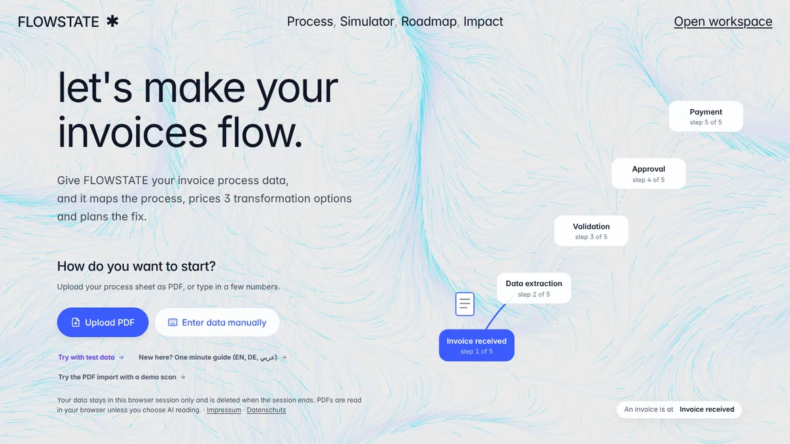

# FLOWSTATE

**Live:** https://flowstate.nadin.dev



**AI-assisted digital transformation & project intelligence platform**.

FLOWSTATE turns a business problem into a measurable transformation project: analyse a process, find the bottlenecks, get ranked interventions, compare three transformation scenarios with transparent ROI maths, plan the implementation and track KPIs — then export a report.

FLOWSTATE starts **empty**: no company, no figures, no tasks. It provides the structure for invoice-processing automation — the five process steps (Invoice received → Data extraction → Validation → Approval → Payment), three scenario types and five roadmap phases — and you enter your own values. A setup checklist on the Overview shows what is still missing.

> **Private sessions.** Every browser gets its own isolated session. Data is never written to disk and is deleted when the visitor clicks *End session & delete data*, after a period of inactivity (default 30 minutes) or when the browser is closed. Savings and ROI are model estimates based on your inputs, never measured outcomes; the UI labels every number as *Input*, *Estimate*, *Simulated* or *Measured*.

---

## Project documents

`docs/` holds the project documents: [PRD](docs/PRD.md) · [Architecture](docs/ARCHITECTURE.md) · [Rules](docs/RULES.md) · [Design](docs/DESIGN.md) · [Methodology](docs/METHODOLOGY.md).

## Quick start

Requirements: **Node.js 20+**.

```bash
npm install
npm run build        # client bundle, standalone HTML and server bundle
npm start            # → http://127.0.0.1:3000
```

| Script | What it does |
|---|---|
| `npm run build` | Bundles the React client to `dist/`, a single-file app to `dist/flowstate-standalone.html`, and the server to `dist-server/server.mjs` |
| `npm start` | Runs the server (static client + API + JSON persistence) |
| `npm run dev` | Rebuilds once and restarts the server on change |
| `npm test` | Unit tests for the finance engine, recommendations, roadmap and KPI logic (`node:test`) |
| `npm run a11y` | WCAG AA contrast check of every page, all themes, light and dark (needs a running server on port 3999) |
| `npm run e2e` | Drives the full user journey in headless Chromium (93 checks, screenshots + PDF in `e2e-output/`) |
| `npm run typecheck` | TypeScript strict type check |

The welcome hero uses an animated **TOPOLOGY** background in the style of Vanta.js (same options: cyan 0x00dfff lines on 0xeaeaea, mouse/touch controls, scale 1) — implemented in-house on a canvas (`src/ui/components/vanta.ts`), so it needs no p5.js/Vanta scripts and no CDN, and works on every host and offline. It pauses when hidden; with reduced motion a static pattern is drawn.

`dist/flowstate-standalone.html` runs without a server (double-click it): data then lives in the tab's sessionStorage and is gone when the tab closes; AI is unavailable.

## Privacy, security & legal

- **Provider details:** name and e-mail for the provider notice (§ 18 MStV) are set in `src/legal.config.ts` and the *Impressum* and *Datenschutz* pages are linked from the start page and the sidebar.
- **No third-party requests:** the Inter font (OFL) and the hero animation are self-hosted; the CSP allows only the own origin. The e2e suite fails if any request leaves the origin.
- **No consent banner needed:** no tracking; only technically necessary storage (sessionStorage, and the session cookie in server mode).
- **AI:** data reaches Anthropic only when the user triggers an AI function; the UI says so before sending.
- **Headers:** CSP, HSTS, Permissions-Policy, COOP, nosniff, frame-ancestors none.
- **Dependencies:** `.github/dependabot.yml` and `.github/workflows/ci.yml` (audit, tests, builds, e2e). Commit `package-lock.json` after the first `npm install`.
- **Licences:** `THIRD_PARTY_NOTICES.txt` is generated from the bundles (`npm run build`) and served at `/third-party-notices.txt`. The project itself: `LICENSE` (all rights reserved; private application project).

## Configuration

The optional consultant functions read `ANTHROPIC_API_KEY` and `FLOWSTATE_AI_MODEL` from the environment (see `.env.example`). Without a key the app runs fully on its built in rules. The legal provider details live in `src/legal.config.ts`.

Built by Nadin Okil.
